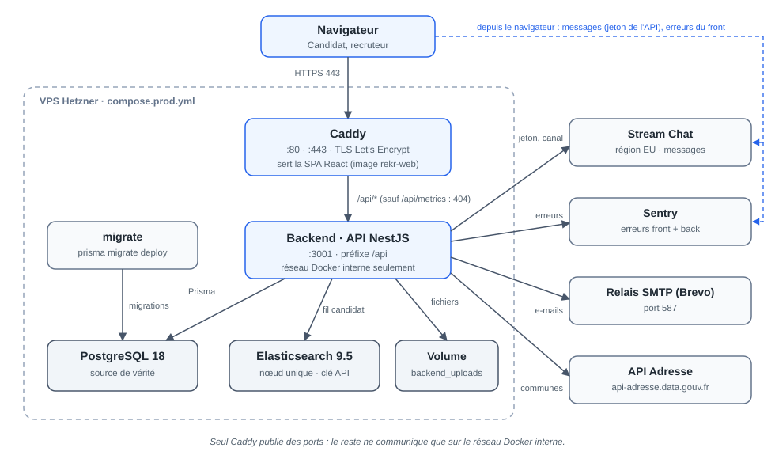
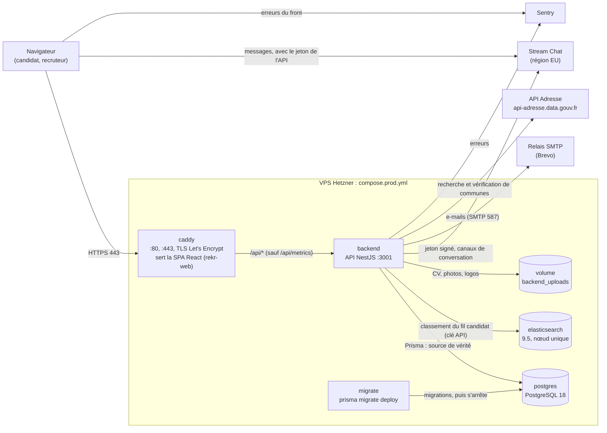
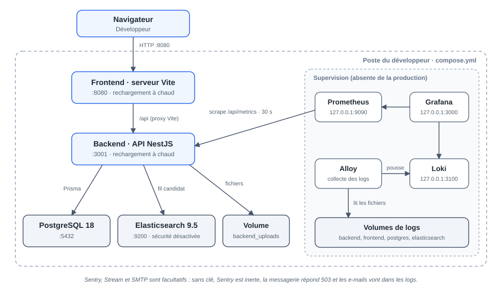
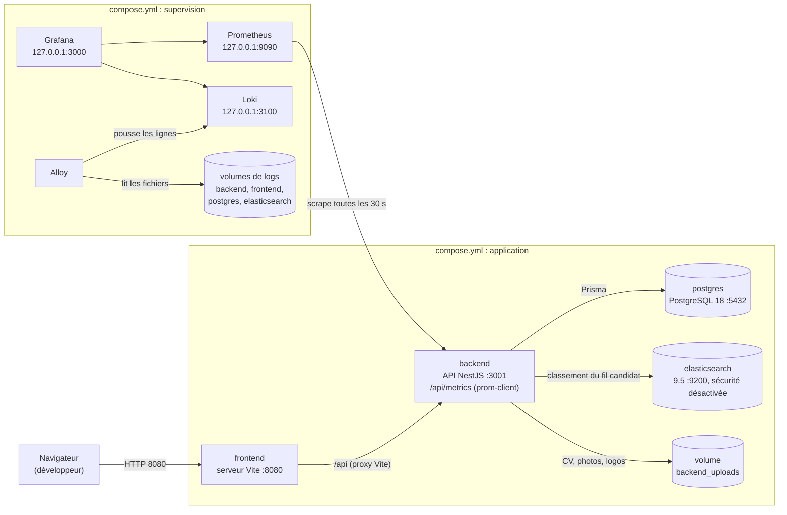
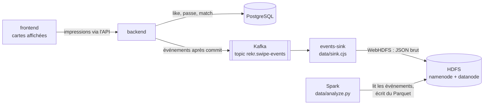
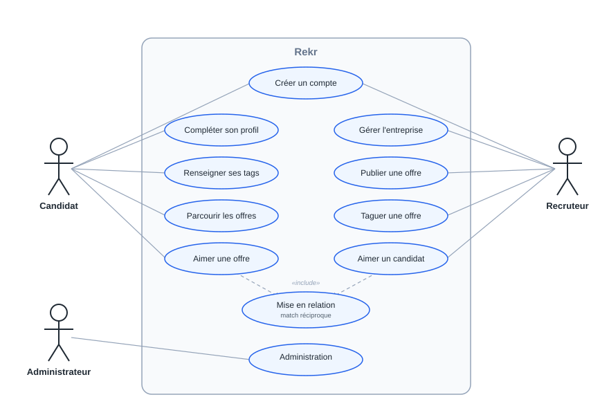
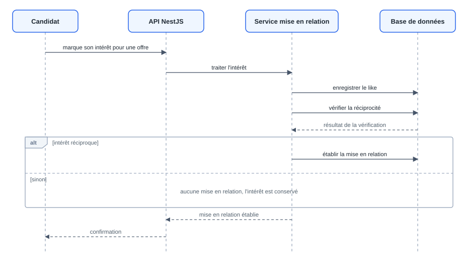
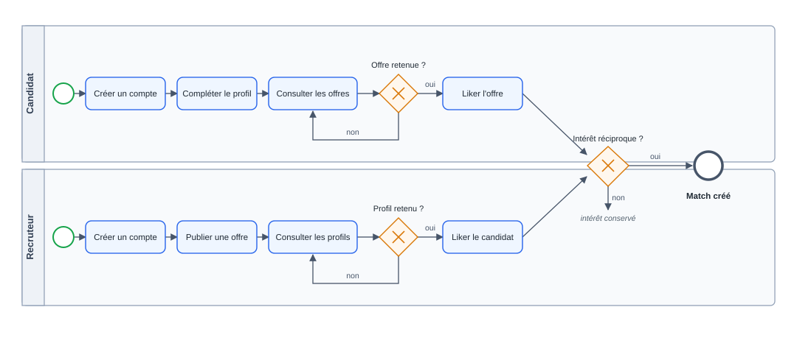

# Architecture

Ce document décrit les composants de Rekr et leurs flux tels que le code et les fichiers Compose les montrent. Il distingue trois piles (la production tourne seule, le prototype data se lance par-dessus la pile de développement) :

| Pile | Fichier | Où |
| --- | --- | --- |
| Production | `compose.prod.yml` | VPS Hetzner, déployé par la CI |
| Développement | `compose.yml` | poste du développeur |
| Prototype data | `compose.data.yml` (avec `compose.yml`) et `docker/docker-compose.yml` | poste du développeur, à la demande |

Les choix qui ont mené à cette architecture sont dans les [ADR](adr/README.md). La procédure de déploiement est dans [deploiement-vps.md](deploiement-vps.md).

## Production

Seul `compose.prod.yml` décrit la production : Caddy, `backend`, `migrate`, PostgreSQL et Elasticsearch, sur un VPS de 2 Go de RAM. Kafka, HDFS, Spark, Prometheus, Grafana, Loki et Alloy n'y sont pas.

Source Mermaid du schéma

### Composants

| Composant | Rôle | Sources |
| --- | --- | --- |
| `caddy` | Seul service exposé (80 et 443). Obtient le certificat, sert la SPA construite depuis `clientApp/` (image `rekr-web`), transmet `/api/*` au backend et pose un `X-Request-Id`. Répond 404 sur `/api/metrics`. | `docker/caddy/Caddyfile` |
| `clientApp` | Front React + Vite. En production, il n'existe pas de conteneur front : le build est servi par Caddy. | `clientApp/` |
| `backend` | API NestJS 11, préfixe `/api`, joignable seulement sur le réseau Docker interne. | `backend/src/` |
| `migrate` | Applique les migrations Prisma avant le démarrage du backend, puis s'arrête. | `compose.prod.yml` |
| PostgreSQL | Source de vérité : comptes, profils, offres, likes, passes, matchs. | `backend/prisma/schema.prisma` |
| Elasticsearch | Choisit seulement l'ordre des offres du fil candidat. PostgreSQL revérifie l'éligibilité ; si Elasticsearch ne répond pas, le fil retombe sur l'ordre PostgreSQL. | `backend/src/search/`, [ranking-du-feed-candidat.md](ranking-du-feed-candidat.md) |
| Volume `backend_uploads` | Fichiers téléversés. Il fait partie des sauvegardes au même titre que PostgreSQL. | `backend/src/storage/` |

### Flux

1. **Navigation.** Le navigateur charge la SPA depuis Caddy ; les fichiers sous `/assets/` sont mis en cache définitivement, `index.html` est revalidé à chaque visite.
2. **API.** Le front appelle `/api/*` sur le même domaine ; Caddy transmet au backend (un seul proxy, `TRUST_PROXY_HOPS=1`).
3. **Fil candidat.** Le backend demande à Elasticsearch des identifiants d'offres classés (index `rekr-offers-v2`), puis relit les offres dans PostgreSQL et écarte celles qui ne sont plus éligibles.
4. **Like et mise en relation.** Un like ou une passe est enregistré dans PostgreSQL ; quand l'intérêt est réciproque, le backend crée le match (voir la [séquence](#diagrammes)).
5. **Messagerie.** Le backend signe un jeton Stream d'une heure (`POST /api/chat/token`) et prépare le canal du match (`POST /api/matches/:id/chat`). Le navigateur échange ensuite les messages directement avec Stream. Le secret Stream reste côté backend.
6. **E-mails.** Le backend envoie par SMTP ; aujourd'hui, seule la réinitialisation du mot de passe envoie un e-mail. Le code ne connaît qu'un relais SMTP générique ; Brevo est le relais indiqué dans `.env.prod.example`.
7. **Communes.** Le backend interroge l'API Adresse pour proposer et vérifier les communes, avec un cache en mémoire.
8. **Erreurs.** Le backend (`backend/src/instrument.ts`) et le front (`clientApp/instrument.js`) envoient leurs erreurs à Sentry quand un DSN est fourni ; sans DSN, le SDK reste inerte.

### Livraison

La CI (`.github/workflows/ci-cd.yml`) construit les images `rekr-web`, `rekr-backend` et `rekr-migrate`, les pousse sur GHCR avec le hash du commit, puis lance `scripts/deploy/rekr-deploy` sur le serveur. Le serveur ne construit rien : il tire les images et relance `compose.prod.yml`.

## Développement

`compose.yml` lance `postgres`, `elasticsearch` (sécurité désactivée, port 9200 publié), `backend` (rechargement à chaud) et `frontend` (serveur Vite sur 8080, qui relaie `/api` vers le backend). Sentry, Stream et SMTP sont facultatifs : sans clé, Sentry est inerte, la messagerie répond 503 et les e-mails sont seulement journalisés.

La même pile embarque la démonstration de supervision, absente de la production :

Source Mermaid du schéma

- **Prometheus** lit `http://backend:3001/api/metrics` (`docker/prometheus/prometheus.yml`).
- **Alloy** lit les fichiers de logs des quatre services et les pousse vers **Loki** (`docker/alloy/config.alloy`).
- **Grafana** interroge Prometheus et Loki, avec des tableaux de bord provisionnés (`docker/grafana/provisioning/`).
- `/api/metrics` n'a pas de garde dans l'API. En production, Caddy le bloque (404) : seul le réseau interne pourrait le lire, et aucun Prometheus n'y tourne.

Détails et tableaux de bord : [grafana-prometheus.md](grafana-prometheus.md).

## Prototype data

Deux piles locales, indépendantes de la production, utilisent Kafka.

### Analyse des swipes : Kafka, HDFS, Spark

Lancée par `docker compose -f compose.yml -f compose.data.yml --profile data up -d`. Le fichier active `SWIPE_EVENTS_ENABLED` côté backend et `VITE_DATA_ANALYTICS_ENABLED` côté front.

L'envoi est best-effort : au plus 20 événements en attente, les autres sont abandonnés avec un avertissement, sans bloquer la requête. Spark se lance à la demande (profil `data-jobs`). Guide complet : [data/README.md](../data/README.md).

### Pipeline de logs : Kafka vers PostgreSQL

`docker/docker-compose.yml` est une pile à part (Kafka, Kafka UI, PostgreSQL, backend sans Elasticsearch, frontend, `logs-sink`). Les routes admin `POST /api/logs/sample` et `POST /api/logs/error` publient un événement sur le topic `logs.raw` ; `logs-sink` le consomme et l'écrit dans la table `logs_raw`. La procédure est dans le [README](../README.md#kafka--logs).

## Diagrammes

Les deux schémas d'architecture sont le rendu des sources Mermaid des sections [Production](#production) et [Développement](#développement) : modifier l'un impose de modifier l'autre. Les trois autres diagrammes viennent du dossier de projet.

| Diagramme | Fichier |
| --- | --- |
| Architecture de production | [schema-architecture-production.svg](diagrams/schema-architecture-production.svg) |
| Architecture de développement | [schema-architecture-developpement.svg](diagrams/schema-architecture-developpement.svg) |
| Cas d'utilisation (candidat, recruteur, administrateur) | [cas-d-utilisation.svg](diagrams/cas-d-utilisation.svg) |
| Séquence de la mise en relation | [sequence-mise-en-relation.svg](diagrams/sequence-mise-en-relation.svg) |
| BPMN du parcours candidat et recruteur | [bpmn-parcours.svg](diagrams/bpmn-parcours.svg) |

